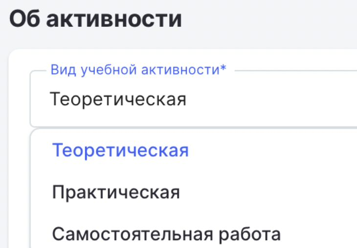
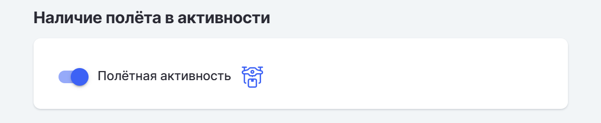

Образовательный контент, который проходят слушатели в рамках программы, размещается в активностях. Каждая активность имеет определенный тип и вид. На основании структуры программы, образовательных активностей и материалов формируются цифровые следы методиста, передаваемые в Университет 2035.

Перед созданием активности рекомендуется свериться с вашей учебной программой. Определите, какие часы предусмотрены для данной активности -- теоретические, практические или самостоятельная работа, -- и в соответствии с этим выберите подходящий вид учебной деятельности в Odin.

{width=730px height=508px}

В зависимости от выбранного **вида учебной деятельности** в системе становятся доступны различные типы образовательных активностей.

Для **теоретической** учебной деятельности доступны следующие типы активностей:

-  Лекция;

-  Консультация;

-  Другое.

Данные типы активностей предназначены для организации теоретического обучения, например просмотра видеоматериалов, участия в вебинарах, изучения текстовых материалов и другого образовательного контента, не предполагающего выполнение практического задания.

Для **практической** учебной деятельности доступны:

-  Форум;

-  Лабораторная;

-  Практика;

-  Семинар;

-  Задание;

-  Контрольная.

Данные типы активностей используются, когда в рамках обучения слушатель должен выполнить какое-либо действие: загрузить решение, пройти тестирование, принять участие в практическом занятии или выполнить иную практическую работу.

Для **самостоятельной работы** доступны:

-  Самостоятельная работа;

-  Другое.

Данные типы активностей предназначены для самостоятельного изучения учебного материала. В рамках таких активностей слушатель самостоятельно осваивает образовательный контент, например, изучает текстовые материалы, просматривает видеозаписи.

Доступность типа активности определяется выбранным видом учебной деятельности и **не зависит от блока**, в котором создается активность. При этом расположение активности в теоретическом, практическом или ином блоке влияет на состав передаваемого цифрового следа методиста.

При создании активности необходимо учитывать ее назначение. Обычные образовательные активности размещаются внутри соответствующего модуля и темы в соответствии со структурой учебной программы.

Для аттестационных активностей расположение определяется объектом аттестации: активность может относиться к отдельному модулю или блоку в целом. В зависимости от этого она создается на соответствующем уровне программы.

В зависимости от направления, указанного в программе, активности могут иметь переключатель "Полетная активность", этот переключатель включает в форме редактирования активности набор полей относящихся к расширениям фактов деятельности для полетных активностей.

**Рассмотрим часто используемые типы образовательных активностей и особенности их настройки в Odin.**

**Лекция** 

Активность с типом **«Лекция»** используется для размещения теоретического контента и может применяться для проведения вебинаров или размещения видеоматериалов.

При создании активности необходимо указать:

-  название активности;

-  описание;

-  признак обязательности обучения;

-  количество академических часов;

-  формат проведения активности.

В зависимости от выбранного формата необходимо заполнить дополнительные параметры:

**Если лекция проводится в формате вебинара в Odin:**

-  укажите дату и время проведения.

**Если вебинар проводится во внешнем сервисе:**

-  укажите дату и время проведения;

-  добавьте ссылку на вебинар.

**Если активность предназначена для видеоматериала:**

-  выберите формат самостоятельного изучения;

-  добавьте необходимый видеоматериал в качестве материала активности.

**Практика** 

Активность с типом **«Практика»** используется в случаях, когда необходимо передать факт деятельности слушателя без прикрепления подтверждающих материалов с его стороны.

Активность может проводиться, например, в формате практического занятия или вебинара.

При создании активности необходимо указать:

-  название активности;

-  описание;

-  количество академических часов;

-  признак обязательности выполнения;

-  формат проведения активности.

Для активности с типом **«Практика»** необходимо также заполнить обязательные параметры в разделе **«Расширения БАС»**.

**Самостоятельная**

Активность с типом **«Самостоятельная работа»** предназначена для самостоятельного изучения слушателем образовательного контента.

Для корректного формирования цифрового следа по данной активности **необходимо добавить материал**. В качестве материала может использоваться:

-  текстовый материал;

-  видеоматериал.

Например, в текстовый материал можно включить список литературы для самостоятельного изучения, перечень вопросов для самопроверки, дополнительные материалы или другие рекомендации по освоению темы.

При создании активности необходимо указать:

-  название активности;

-  описание;

-  количество академических часов;

-  признак обязательности обучения;

-  формат активности;

-  добавить материал.

После добавления необходимого материала активность будет учитываться при формировании цифрового следа методиста, передаваемого в Университет 2035.

### **Задание**

Активность с типом **«Задание»** используется в случаях, когда слушателю необходимо выполнить работу, загрузить решение в систему и получить результат проверки (оценку).

В зависимости от расположения активности в структуре образовательной программы и установленных признаков она может использоваться для разных целей.

**Задание в теоретическом блоке**

Если активность с типом **«Задание»** размещена в теоретическом блоке, она относится к теоретической активности. По такой активности передача факта деятельности (ФД) не осуществляется.

Также активность  с типом **«Задание»** может использоваться для проведения промежуточной аттестации. В этом случае необходимо установить признак **«Аттестация»** и заполнить необходимые расширения.

**Задание в практическом блоке**

Если необходимо передать факт деятельности (ФД) и получить подтверждающий материал от слушателя, следует использовать активность с типом **«Задание»** в практическом блоке.

Для такой активности необходимо:

-  заполнить раздел **«Расширения БАС»**;

-  после выполнения активности заполнить отчет по ФД.

Активность также может использоваться для проведения промежуточной аттестации по модулю или по всему практическому блоку. В таком случае необходимо установить соответствующий признак:

-  **«Аттестация»** -- если активность является промежуточной аттестацией по модулю/блоку;

-  **«Аттестация по блоку»** -- если активность является аттестацией по всему блоку.

Если одна активность одновременно является промежуточной аттестацией по модулю и по блоку в целом, необходимо установить оба признака.

Также требуется: 

-  заполнить раздел **«Расширения БАС»**;

-  после выполнения активности заполнить отчет по ФД.

**Задание в блоке с типом «Другое»**

Активность с типом **«Задание»**, размещенная в блоке типа **«Другое»**, используется для проведения итоговой аттестации по программе. Создается без модулей и тем.

Для такой активности необходимо:

-  установить признак **«Аттестация»**;

-  заполнить необходимые расширения;

-  после проведения активности заполнить отчет по фактам деятельности.

### **Контрольная**

Активность с типом **«Контрольная»** используется для проведения тестирования слушателей. Для такой активности обязательно необходимо добавить материал с типом **«Тест»** из библиотеки Odin.

Подробную информацию о тестах в Odin можно прочитать здесь - <https://www.odin.study/help/servisy/biblioteka/materialy/test/README>. Вся информация о тесте (вопросы, проходной балл) будет также передана в составе ЦС методиста.

В зависимости от расположения активности в структуре образовательной программы и установленных признаков контрольная может использоваться для разных целей.

**Контрольная в теоретическом блоке**

Если активность с типом **«Контрольная»** размещена в теоретическом блоке, она относится к теоретической активности.

Такая активность может использоваться для проверки знаний или самопроверки слушателя.

Если контрольная является промежуточной аттестацией, необходимо установить признак **«Аттестация»** и заполнить необходимые расширения.

**Контрольная в практическом блоке**

Если необходимо передать факт деятельности  по практической активности (ФД) и при этом провести тестирование, следует использовать активность с типом **«Контрольная»**. Для такой активности необходимо:

-  добавить материал типа **«Тест»**;

-  заполнить раздел **«Расширения БАС»**;

-  после проведения заполнить отчет ФД.

Также контрольная в практическом блоке может использоваться для:

-  промежуточной аттестации по модулю;

-  промежуточной аттестации по итогам практического блока.

Для этого необходимо установить соответствующие признаки в настройках активности:

-  **«Аттестация»** -- если активность является промежуточной аттестацией по модулю;

-  **«Аттестация по блоку»** -- если активность является аттестацией по всему практическому блоку.

Если одна активность одновременно является промежуточной аттестацией по модулю и по итогам практического блока, необходимо установить оба признака.

**Контрольная в блоке с типом «Другое»**

Если активность с типом **«Контрольная»** размещена в блоке типа **«Другое»**, она используется для проведения итоговой аттестации по программе. Создается без модулей и тем.

В этом случае необходимо установить признак **«Аттестация»** и заполнить необходимые параметры активности.

Важно: Аттестация всегда должна быть связана с активностью типа "Задание" или "Контрольная", так как только эти активности подразумевают добавление ответов студентами в LMS.

ВАЖНО! 

При настройке активностей важно учитывать, что тип передаваемого ЦСМ определяется не только типом активности, но и ее расположением в структуре программы, а также установленными признаками (например, аттестация). Таблица соответствий ЦСМ и настроек активностей приведена в статье 

(+ тут ссылка на новую статью)

**Материалы** добавляются непосредственно на странице редактирования активности.

Любой материал, добавляемый на платформу (видеоматериалы, презентации и т.д.), должен соответствовать требованиям У2035 и иметь описание. Описание добавляется не сразу при загрузке, а уже далее на странице редактирования материала в поле "Описание".

Именно это описание будет использоваться в ЦС методиста для описания материалов программы.

Q: Могут ли в теоретическом блоке быть практические активности и наоборот?

A: Да, такие варианты возможны -- как практические активности в теоретическом блоке, так и теоретические активности в практическом блоке.

Q: Какой тип активности указывать, если студент должен отправить решение на проверку?

A: Для этого предусмотрены два типа активности: "Задание" и "Контрольная".

В проекте БАС образовательные активности могут иметь признак того, что они являются обязательными к изучению/прохождению, либо же необязательными.

Такая разметка применима к:

\- Текстовым элементам презентации

\- Видеоматериалам

\- Теоретическим активностям

\- Практическим активностям.

Теперь на странице редактирования активностей с типами «Практика», «Самостоятельная работа», «Лабораторная», «Семинар» в разделе «Расширения БАС» вы можете разметить обязательные активности, проставив чекбокс «Обязательная для изучения активность».

До окончания ваших потоков проверьте, что в программе есть активности с типом "Задание" или "Контрольная", у которых нет галки аттестации. Это будет означать, что у вас есть обязательные активности. Тогда при проверке вопросов к требованию 7 не должно будет возникнуть.

Если же таких активностей нет, проставьте обязательность активностям с типами «Практика», «Самостоятельная работа», «Лабораторная», «Семинар» (на ваше усмотрение).

Главное требование У2035 по этому вопросу - чтобы у вас не отсутствовали обязательные активности в принципе.

\______\_

Образовательные активности в Odin могут быть различных типов: лекция, задание, самостоятельная работа, контрольная и т.д. Все активности добавляются через страницу блока (дисциплины).

Согласно документации проекта БАС, активности могут быть теоретическими и практическими. Также в рамках программы могут присутствовать и другие структурные элементы, например, лекции.

**Заполнение теоретического блока**

1\. Добавьте [модули и темы](./dobavlenie-modulei-i-tem).

2\. Добавьте необходимые активности обязательно в состав модуля.

.png>)

3\. Укажите данные по активности: тип, время проведения, формат и т.д. Общую информацию о заполнении активностей можно посмотреть в нашей базе знаний здесь.

Если активность является промежуточной аттестацией по модулю, установите галочку "Аттестация" на странице редактирования активности. Эта активность должна находиться внутри модуля.

Важно: Аттестация всегда должна быть связана с активностью типа "Задание" или "Контрольная", так как только эти активности подразумевают добавление ответов студентами в LMS.

В зависимости от трека, указанного в программе, активности могут иметь переключатель "Полетная активность", этот переключатель включает в форме редактирования активности набор полей относящихся к расширениям фактов деятельности для полетных активностей.

{width=1181px height=244px}

4\. Добавьте все необходимые материалы в активность (презентации, видеоматериалы и т.д. -- по ним также передается цифровой след методиста).

Если активность -- "Контрольная", прикрепите к ней материал с типом "Тест" из вашей библиотеки в Odin, чтобы студенты могли её пройти. Подробную информацию о тестах в Odin можно прочитать здесь. Вся информация о тесте (вопросы, проходной балл) будет также передана в составе ЦС методиста.

5\. Сохраните активность.

**Заполнение практического блока.**

Практический блок заполняется аналогично теоретическому с двумя различиями:

1\. Поскольку этот блок предполагает наличие практических активностей, на странице редактирования таких активностей дополнительно появится раздел "Расширения БАС", который необходимо заполнить для сохранения активности.

2\. В практическом блоке предусмотрена аттестация как по отдельным модулям, так и по всему практическому блоку. (см. документацию У2035) Для такого испытания создайте в практическом блоке активность с типом "Задание" или "Контрольная" вне модулей.

**Заполнение блока с итоговой аттестацией по программе**

1\. Этот блок должен иметь тип "Другое".

2\. В блоке создайте активность с типом "Задание" или "Контрольная работа" (без модулей и тем).

Если активность -- "Контрольная", прикрепите к ней материал с типом "Тест" из вашей библиотеки в Odin, чтобы студенты могли её пройти. Подробности о тестах в Odin можно найти здесь. Вся информация о тесте будет передана в составе ЦС методиста.

3\. Укажите необходимые данные по активности: тип, время проведения, формат и т.д. Обязательно указание даты и времени активности, так как даты проведения активности влияют на ЦС по видеоконтенту.

4\. Сохраните активность.

**Материалы** добавляются непосредственно на странице редактирования активности.

Любой материал, добавляемый на платформу (видеоматериалы, презентации и т.д.), должен соответствовать требованиям У2035 и иметь **описание**. Описание добавляется не сразу при загрузке, а уже далее на странице редактирования материала в поле "Описание".

.png>)

Именно это описание будет использоваться в ЦС методиста для описания материалов программы.

.png>)

:::tip 

Q: Могут ли в теоретическом блоке быть практические активности и наоборот?

A: Да, такие варианты возможны -- как практические активности в теоретическом блоке, так и теоретические активности в практическом блоке.

Q: Какой тип активности указывать, если студент должен отправить решение на проверку?

A: Для этого предусмотрены два типа активности: "Задание" и "Контрольная".

:::

В проекте БАС образовательные активности могут иметь признак того, что они являются обязательными к изучению/прохождению, либо же необязательными.

Такая разметка применима к:

\- Текстовым элементам презентации

\- Видеоматериалам

\- Теоретическим активностям

\- Практическим активностям.

Теперь на странице редактирования активностей с типами «Практика», «Самостоятельная работа», «Лабораторная», «Семинар» в разделе «Расширения БАС» вы можете разметить обязательные активности, проставив чекбокс «Обязательная для изучения активность».

.png>)

До окончания ваших потоков проверьте, что в программе есть активности с типом "Задание" или "Контрольная", у которых нет галки аттестации. Это будет означать, что у вас есть обязательные активности. Тогда при проверке вопросов к требованию 7 не должно будет возникнуть.

Если же таких активностей нет, проставьте обязательность активностям с типами «Практика», «Самостоятельная работа», «Лабораторная», «Семинар» (на ваше усмотрение).

Главное требование У2035 по этому вопросу - чтобы у вас не отсутствовали обязательные активности в принципе.